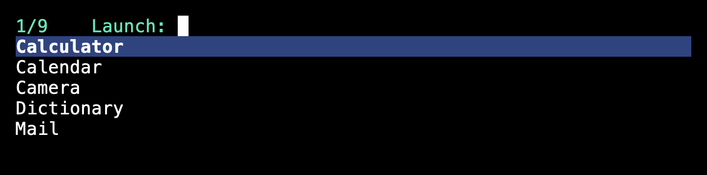
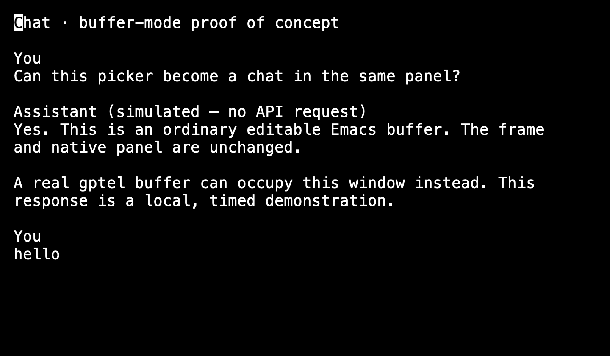

# Prototype: a compact picker in a normal buffer panel

**Throwaway experiment on `prototype/buffer-picker`, not a replacement for either
existing presentation kind.** No production Portal or native implementation was
changed. The demo uses a fake application list and a simulated chat response;
it does not launch applications, call an LLM, or configure global shortcuts.

## Question and verdict

Can a normal `:kind 'buffer` panel look close to the current minibuffer-only
picker, then become an editable result buffer without replacing the frame or
closing the native panel?

**Yes, in the tested VM.** Vertico's buffer extension displays the prompt and
candidates in the panel's ordinary window. After `c SPC`, the minibuffer exits
normally, the ordinary window changes buffers, and a recursive edit keeps the
same Portal session open. Timed text insertion demonstrates asynchronous output
while the user can type in the result buffer.

```text
one Portal presentation / native session / normal Emacs frame
  picker: prompt and Vertico candidates in the ordinary window
    ├─ Return → return the selected string and dismiss
    ├─ Escape → cancel and dismiss
    └─ c SPC → exit prompt → editable result buffer → Escape dismisses
```

The exact compact appearance is not identical: a normal frame retains a blank
minibuffer/echo row at the bottom. With Menlo 18 in this VM, that row is 21 logical
points. There is no empty ordinary buffer above the picker and no mode line.

## Screenshots

These are actual Emacs drawing-surface captures from the VM, not mockups. They
exclude the native panel's shadow and rounded corners. Images are Retina 2×;
measurements below are logical points. Both versions use the same fake candidates,
font, theme, width, and five-row cap.

| State | Existing minibuffer-only panel | Normal-buffer prototype |
| --- | --- | --- |
| Five candidates | 720 × 158 | 720 × 179 |
| `Cal`, two candidates | 720 × 100 | 720 × 116 |
| No matches | Not measured in this comparison | 720 × 100 |
| Result buffer | Not supported by this presentation kind | 720 × 420 |

### Existing minibuffer-only picker (unchanged)


### Full-buffer picker



### Full-buffer picker after typing `Cal`


[Compare the existing filtered minibuffer-only picker](evidence/buffer-picker-prototype/02-minibuffer-filtered.png).

### Same frame and native session after `c SPC`



The test types `hello` into the result buffer while local timed chunks are
inserted above its input area, then moves to the transcript's beginning for this
screenshot. This is not a screenshot of gptel and is not evidence of an LLM call.

## Try it

With a compatible, built Portal and Vertico available, load the experimental file
from this worktree and invoke its command:

```elisp
(load-file "/path/to/portal.worktrees/buffer-picker/portal-launcher-buffer-prototype.el")
```

Then run `M-x portal-launcher-buffer-prototype`.
Alternatively, after adding this worktree to `load-path`:

```elisp
(require 'portal-launcher-buffer-prototype)
(portal-launcher-buffer-prototype)
```

Type `Cal` to narrow, delete to regrow, select with arrows/Return, or type `c SPC`
to switch immediately to the result. Escape closes it. Selected application names
are returned, not executed. The result buffer is retained after dismissal, just
like other Portal buffer UIs. The demo temporarily enables Vertico if necessary
and restores that setting on exit; it does not globally enable vertico-buffer.

Follow [Portal's disposable-session safety guidance](launcher.md#set-up-safely).
The automated GUI run must use the VM:

```sh
PORTAL_TEST_VM=portal-vm bash test/vm.sh sh test/launcher-buffer-prototype.sh
```

The runner prints the remote run directory. Screenshots are saved to its sibling
`screenshots/` directory, outside `repo/`, so they survive successful-run cleanup.
Fetch them with `rsync` or `scp` from that printed directory. This experiment used
`PORTAL_TEST_VM=xiaoxing@192.168.64.6` because the local mDNS name selected an
unreachable IPv6 address; IPv4 SSH worked.

## Implementation findings

- `vertico-buffer-mode` is dynamically enabled only while reading the picker.
  A scoped display action targets the panel's existing ordinary window rather
  than allowing Portal's usual buffer-display rule to split it.
- Vertico normally derives its candidate count from the window height. The demo
  instead fixes a five-row cap and fits the panel to measured content. Otherwise
  shrinking the window also reduces the candidates shown and prevents regrowth.
- The first GUI run exposed a real small-frame failure: stock vertico-buffer
  tries to shrink the actual minibuffer on every redisplay. With a 100-point
  panel, the root was 47 points, its configured minimum 84, and the mini window
  21; Emacs's clamping attempted a **−16-point** minibuffer and reported
  `args-out-of-range`. The prototype retains the existing one-row mini window
  and only scrolls its duplicate prompt out of view. It does not change Emacs's
  minimum-window settings. Subsequent GUI runs fitted and regrew correctly.
- Sizing reuses Portal's existing native layout-only `portal--launcher-fit`
  primitive. This changes height without starting a new native session, moving
  the top edge, or requesting focus. The core's current `:kind` rules are untouched.
- `c SPC` returns a route from the reader. Only after minibuffer exit and Vertico
  cleanup does the demo switch buffers. The ordinary result command loop remains
  inside Portal's existing cancellation catch and display rules.

## Verification and limits

The GUI suite drives native AppKit key events in a disposable Emacs in the VM.
It covers picker selection, filtering, shrink/regrow, unmatched input, Escape,
reentry, ordinary-window rendering, no mode line, content not clipped, fixed
left/top edges, and unchanged frame/native session across the result transition.
It also runs the existing minibuffer-only Vertico and persistent-buffer checks.
The demo's asynchronous insertion is local and credential-free.

Final verification on 2026-10-06 (the VM clock reports 2026-10-05 PDT):

- VM: **7/7 GUI tests passed**, none skipped; [complete GUI log](evidence/buffer-picker-prototype/gui-tests.log).
- Host: `./build.sh` passed; **34/34 CTest suites passed** on the final full run;
  [complete CTest log](evidence/buffer-picker-prototype/host-ctest.log).
- Host: `bun run --cwd host check` and `bun run --cwd host typecheck` passed;
  Python unittest discovery passed **8/8**.
- Prototype and GUI test byte compilation completed without warnings.
- The first host CTest run had an unrelated 5-second timeout in the existing
  VM-runner test. That suite passed on isolated rerun and on the final full run;
  no runner code was changed.

Environment: Portal baseline `c750e25`, its required GNU Emacs NS 31.1 revision
`a360712c9d272d950d8d8255ef74570f7e90b7d9`, CMake-pinned Vertico 2.15,
Menlo 18, Modus Vivendi, 2× screenshot scale. Run the GUI checks with the command
above. Host checks follow [Contributing](../CONTRIBUTING.md#checks-before-a-pr);
native GUI checks were not run on the host.

This is a feasibility result, not a ready-to-merge presentation interface:

- Uses private Portal and Vertico functions, including a scoped replacement of
  Vertico's redisplay function; a production implementation needs a supported seam.
- Height fitting is experimental for this one picker, not a change to generic
  buffer-panel sizing or a new public option.
- Retains one blank echo-area row; it does not crop native content to conceal it.
- Does not exercise the real launcher.el app index, gptel, API credentials,
  physical keys, IME composition, VoiceOver, other completion UIs, or multi-monitor
  transitions. Wrapped input and grouped annotations need further validation.
- Does not implement Back navigation or request cancellation for real tools.
- Both existing `:kind 'minibuffer` and `:kind 'buffer` behaviors remain available
  exactly as before. No automatic migration, configuration edits, or native rebuild
  changes are introduced by the prototype source.
