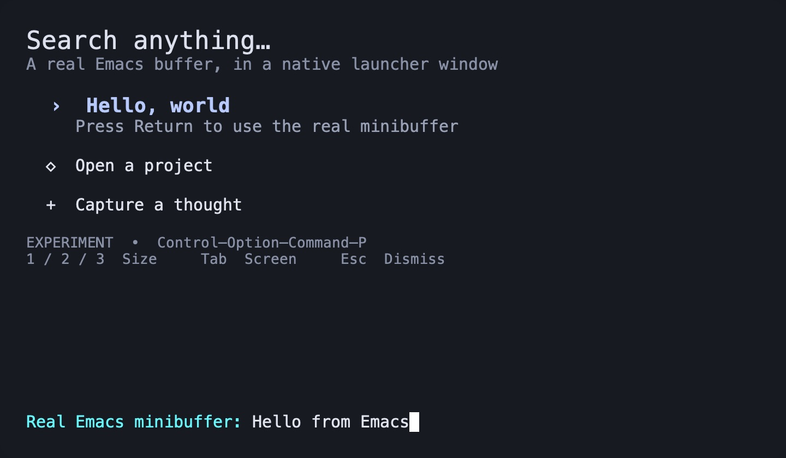

# Native launcher experiment — throwaway

Question: can a module loaded by GUI Emacs summon a launcher-sized, precisely
positioned **real Emacs buffer inside an NSPanel**, without an M-x app?

**Result so far:** real NSPanel hosting, graphical redisplay, keyboard input into
its own minibuffer, pixelwise resizing, and placement on both connected monitors
work on the tested GNU Emacs NS build. The system hotkey registers successfully;
a physical press from another app still needs confirmation. App-targeted automation
did not deliver a global hotkey event. Do not call that final step proven yet.



## Run

From this checkout:

```sh
./launcher-prototype.sh
```

Requires macOS, Xcode Command Line Tools, and a module-enabled GNU Emacs NS build.
Defaults to `/Applications/Emacs.app`; `EMACS` overrides the GUI executable and
`EMACS_INCLUDE` overrides the directory containing `emacs-module.h`.
`./launcher-prototype.sh --build-only` just compiles the module.

The script starts a separate `emacs -Q` with a dedicated
`portal-launcher-prototype` server. It does not load your init, install an app,
or change Portal's production module. Do not load this experiment into a working
Emacs: moving its internal view into another kind of window is experimental.

- **Control–Option–Command–P:** global show/hide; Command–Space is untouched.
- **Return:** ordinary Elisp `read-string` in the panel's own minibuffer.
- **1 / 2 / 3:** 640×320, 720×420, 860×520 logical points.
- **Tab:** cycle monitors. Initially uses the monitor under the pointer.
- **Escape / q:** hide from the demo buffer. **C-g:** cancel the active prompt.
- Clicking another application hides the panel and cancels its active prompt.

Quit the isolated Emacs to remove the shortcut. Alternatively:

```sh
/Applications/Emacs.app/Contents/MacOS/bin/emacsclient \
  -s portal-launcher-prototype -e '(kill-emacs)'
```

The named server is a development/debugging aid. The intended invocation path
does not launch `emacsclient` or any subprocess:

```text
macOS global shortcut
  → native module's Carbon hotkey callback
  → module pipe → queued Emacs command event
  → Elisp selects its persistent frame
  → module positions and presents NSPanel containing the original EmacsView
```

`PORTAL_PROTOTYPE_WINDOW=emacs ./launcher-prototype.sh` retains the original
EmacsWindow as a comparison mode; the measurements below are for NSPanel.

## What was measured

Tested on GNU Emacs 31.1, NS, revision
`a360712c9d272d950d8d8255ef74570f7e90b7d9`, on 2026-10-02.
GUI automation used an otherwise identical local test copy of the Emacs binary
with a distinct bundle identifier so it could not target the user's running
Emacs. That test fixture lived under ignored `build/`, and is not a runtime
requirement or part of the deliverable.

All coordinates below are AppKit logical points (origin at bottom left).
Both displays have backing scale 2. The panel centers within `visibleFrame`,
excluding the menu bar/Dock. Its origin is rounded down to whole logical points,
matching Emacs's integer frame coordinates. This avoids half-point adjustments
for odd window dimensions; there is no character-cell rounding of the size.

| Display | Requested size | Requested and actual x,y | Emacs frame pixel dimensions |
| --- | --- | --- | --- |
| Gigabyte M32U | 640×320 | 960,545 | 640×320 |
| Gigabyte M32U | 720×420 | 920,495 | 720×420 |
| Gigabyte M32U | 860×520 | 850,445 | 860×520 |
| Gigabyte M32U | 713×407 | 923,501 | 713×407 |
| LG ULTRAFINE | 640×320 | 2960,622 | 640×320 |
| LG ULTRAFINE | 720×420 | 2920,572 | 720×420 |
| LG ULTRAFINE | 860×520 | 2850,522 | 860×520 |
| LG ULTRAFINE | 713×407 | 2923,578 | 713×407 |

The second display's global frame starts at **2560,-483**, so the test includes
unequal monitor origins and orientations. An offset of -137 right / +81 down
at 713×407 produced the requested **2786,497** origin exactly.

Additional observed checks:

- Native runtime class `PortalPrototypePanel`, `isKindOfClass:NSPanel = true`,
  first responder `EmacsView`, content bounds equal requested window size.
- Real typed text and submitted minibuffer answers on both displays; no click
  into the panel was required after presentation during these tests.
- Size changes from actual Emacs key bindings; repeated hide/show and relocation.
- Escape dismissal, C-g prompt cancellation, and dismissal of an active prompt.
- Successful global hotkey registration. Injecting the resulting notification
  into the Elisp filter exercises show/hide through the command loop, but does
  **not** validate physical system shortcut delivery.
- Native module compiled with `-Wall -Wextra -Werror`; shell syntax and Elisp
  parentheses checked. Portal build succeeded. All 25 CTest suites passed
  across the initial run and rerun of 8 environment-related failures. Those
  failures were the installed Emacs native compiler missing `libemutls_w`; the
  rerun supplied `LIBRARY_PATH=/opt/homebrew/opt/gcc/lib/gcc/current/gcc/aarch64-apple-darwin25/15`.

Runtime measurements go to `build/launcher-prototype-state.el`, with native
diagnostics in `build/launcher-prototype.log`. The native state includes a
`hotkeyPresses` counter so a real system invocation can be distinguished from
directly calling the presentation command.

## Findings and limits

An NSPanel is an NSWindow subclass; the content remains an EmacsView/NSView.
This experiment moves the existing content view into a borderless,
nonactivating, floating NSPanel. It retains the original EmacsWindow and routes
unrecognized EmacsWindow-specific messages back to it. This is a narrow
compatibility experiment, not a supported embedding API.

Two issues required explicit coordination with Elisp:

1. Calling AppKit's `makeKeyAndOrderFront` on a hidden frame initially showed an
   empty panel: Emacs still considered its frame invisible. Calling
   `make-frame-visible` with `no-focus-on-map` enables redisplay without another
   application-activation request.
2. Selecting the controller frame before cancelling a live minibuffer can move
   that prompt into the controller. The experiment cancels the prompt before
   restoring the selected frame. Native ownership alone does not remove Emacs's
   frame/minibuffer selection rules.

This is encouraging evidence for merging a small presentation/hotkey capability
into Portal while keeping buffer content, keymaps, prompts, and commands in
Elisp. It does not justify committing to a general NSPanel host yet.

Still to validate: physical global shortcut delivery, native fullscreen apps and
Spaces, IME composition, accessibility (the panel AX tree currently exposes only
the dialog), arbitrary packages/child frames, lifecycle changes to the original
frame, and behavior while Emacs is busy. The callback queues an Elisp command,
so a blocked Emacs command loop can delay presentation. Generic selector
forwarding can act on the hidden donor window and is not a production strategy.

No Emacs patches, replacement text renderer, SwiftUI candidate list, or separate
launcher app are involved. The current prototype is intentionally separate from
Portal's production API so it can be discarded or replaced after evaluation.
