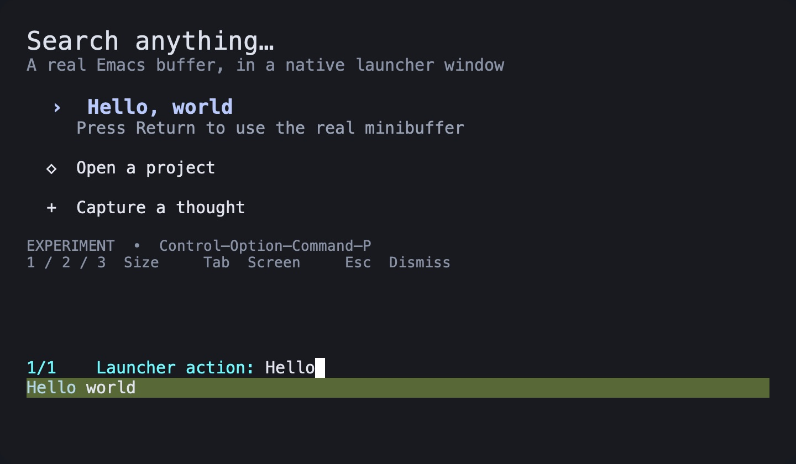
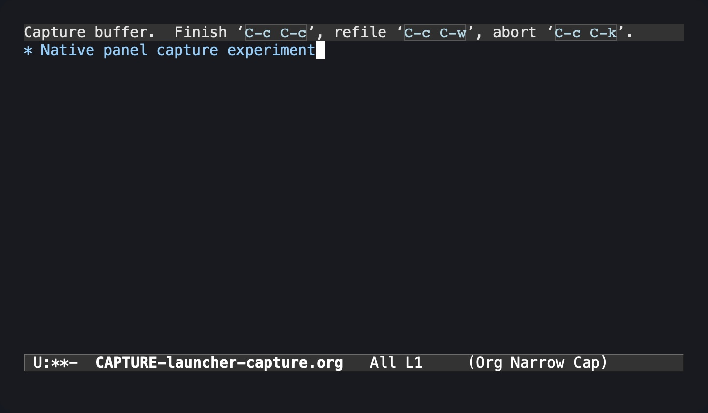
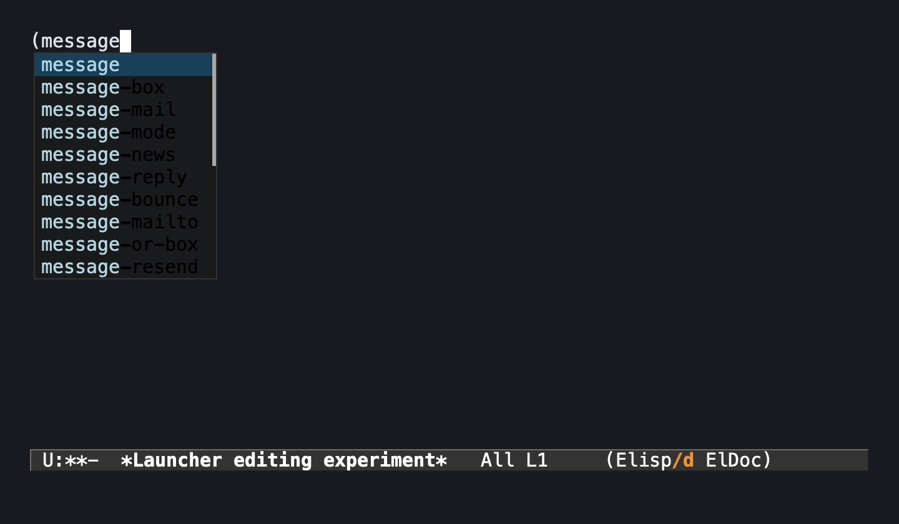

# Native launcher experiment — throwaway

Question: can a module loaded by GUI Emacs summon a launcher-sized, precisely
positioned **real Emacs buffer inside an NSPanel**, without an M-x app?

**Design verdict: proceed with a dedicated, fixed-role launcher frame on the
tested GNU Emacs NS build.** A small in-process module can own a real NSPanel
while buffers, completion, capture, editing, and keymaps remain Elisp. No Emacs
patch or separate launcher app was needed for the demonstrated workflows.

The original generic forwarding implementation is rejected: a routine appearance
change crashed Emacs. The revised experiment replaces it with explicit window
compatibility methods, restores the original window before frame deletion, and
rejects changes to the launcher's native role. This is not a general-purpose
replacement for every EmacsWindow behavior or an unconditional release approval.

Physical global shortcut delivery was subsequently observed: the native callback
recorded four activations, and the real minibuffer returned `hello`. The expanded
experiment passed 62 automated assertions and an additional native dead-key
composition check ([saved results](evidence/launcher-checks.txt)). Fullscreen/Spaces acceptance remains pending a foreground
user check; background-targeted automation cannot establish it reliably.


## Run

From this checkout:

```sh
./launcher-prototype.sh
```

Requires macOS, Xcode Command Line Tools, and a module-enabled GNU Emacs NS build.
Defaults to `/Applications/Emacs.app`; `EMACS` overrides the GUI executable and
`EMACS_INCLUDE` overrides the directory containing `emacs-module.h`.
`./launcher-prototype.sh --build-only` just compiles the module.

`./launcher-prototype.sh --workflows` also loads the installed Vertico, Consult,
Marginalia, Corfu, Posframe, and Compat packages from `elpa/` under Emacs's normal
user directory. `PORTAL_PROTOTYPE_ELPA` can override that location. It loads no
user init and disables JIT native compilation in this isolated test process.
In the demo buffer, **c** opens completion, **o** captures to the scratch file
`build/launcher-capture.org`, **e** opens an editable buffer with Corfu, and
**F8** restores the demo. These commands do not use personal capture templates.

Run `M-x portal-prototype-run-checks`, `M-x portal-prototype-input-checks`, and
`M-x portal-prototype-child-lifecycle-check` in that test Emacs for the automated
checks. Results are written to `build/launcher-workflow-results.el`.

The script starts a separate `emacs -Q` with a dedicated
`portal-launcher-prototype` server. It does not load your init, install an app,
or change Portal's production module. Do not load this experiment into a working
Emacs: moving its internal view into another kind of window is experimental.

- **Control–Option–Command–P:** global show/hide; Command–Space is untouched.
- **Return:** ordinary Elisp `read-string` in the panel's own minibuffer.
- **1 / 2 / 3:** 640×320, 720×420, 860×520 logical points.
- **Tab:** cycle monitors. Initially uses the monitor under the pointer.
- **Escape / q:** hide from the demo buffer. **C-g:** cancel the active prompt.
- Clicking another application hides the panel and cancels its active prompt.

Quit the isolated Emacs to remove the shortcut. Alternatively:

```sh
/Applications/Emacs.app/Contents/MacOS/bin/emacsclient \
  -s portal-launcher-prototype -e '(kill-emacs)'
```

The named server is a development/debugging aid. The intended invocation path
does not launch `emacsclient` or any subprocess:

```text
macOS global shortcut
  → native module's Carbon hotkey callback
  → module pipe → queued Emacs command event
  → Elisp selects its persistent frame
  → module positions and presents NSPanel containing the original EmacsView
```

`PORTAL_PROTOTYPE_WINDOW=emacs ./launcher-prototype.sh` retains the original
EmacsWindow as a comparison mode; the measurements below are for NSPanel.

## What was measured

Tested on GNU Emacs 31.1, NS, revision
`a360712c9d272d950d8d8255ef74570f7e90b7d9`, on 2026-10-02.
GUI automation used an otherwise identical local test copy of the Emacs binary
with a distinct bundle identifier so it could not target the user's running
Emacs. That test fixture lived under ignored `build/`, and is not a runtime
requirement or part of the deliverable.

All coordinates below are AppKit logical points (origin at bottom left).
Both displays have backing scale 2. The panel centers within `visibleFrame`,
excluding the menu bar/Dock. Its origin is rounded down to whole logical points,
matching Emacs's integer frame coordinates. This avoids half-point adjustments
for odd window dimensions; there is no character-cell rounding of the size.

| Display | Requested size | Requested and actual x,y | Emacs frame pixel dimensions |
| --- | --- | --- | --- |
| Gigabyte M32U | 640×320 | 960,545 | 640×320 |
| Gigabyte M32U | 720×420 | 920,495 | 720×420 |
| Gigabyte M32U | 860×520 | 850,445 | 860×520 |
| Gigabyte M32U | 713×407 | 923,501 | 713×407 |
| LG ULTRAFINE | 640×320 | 2960,622 | 640×320 |
| LG ULTRAFINE | 720×420 | 2920,572 | 720×420 |
| LG ULTRAFINE | 860×520 | 2850,522 | 860×520 |
| LG ULTRAFINE | 713×407 | 2923,578 | 713×407 |

The second display's global frame starts at **2560,-483**, so the test includes
unequal monitor origins and orientations. An offset of -137 right / +81 down
at 713×407 produced the requested **2786,497** origin exactly.

Additional observations from the first experiment:

- Native runtime class `PortalPrototypePanel`, `isKindOfClass:NSPanel = true`,
  first responder `EmacsView`, content bounds equal requested window size.
- Real typed text and submitted minibuffer answers on both displays; no click
  into the panel was required after presentation during these tests.
- Size changes from actual Emacs key bindings; repeated hide/show and relocation.
- Escape dismissal, C-g prompt cancellation, and dismissal of an active prompt.
- Successful global hotkey registration. Injecting the resulting notification
  into the Elisp filter exercises show/hide through the command loop, but does
  **not** validate physical system shortcut delivery. A subsequent physical test
  recorded four native hotkey callbacks and the minibuffer answer `hello`.
- Native module compiled with `-Wall -Wextra -Werror`; shell syntax and Elisp
  parentheses checked. Portal build succeeded. All 25 CTest suites passed
  across the initial run and rerun of 8 environment-related failures. Those
  failures were the installed Emacs native compiler missing `libemutls_w`; the
  rerun supplied `LIBRARY_PATH=/opt/homebrew/opt/gcc/lib/gcc/current/gcc/aarch64-apple-darwin25/15`.

Runtime measurements go to `build/launcher-prototype-state.el`, with native
diagnostics in `build/launcher-prototype.log`. The native state includes a
`hotkeyPresses` counter so a real system invocation can be distinguished from
directly calling the presentation command.

## Second experiment: compatibility and real workflows

The initial failure was reproduced with:

```elisp
(set-frame-parameter portal-prototype-frame 'ns-appearance 'dark)
```

The isolated process exited with signal 6. The macOS crash report identified
`-[EmacsWindow setAppearance]` dereferencing address `0x268`: generic forwarding
sent the message into a donor window whose delegate had been cleared. The
method reads an internal Emacs frame through that delegate.

The replacement retains the original delegate and uses exactly two intentional
donor methods: appearance calculation (then applying the resulting appearance
to the panel) and accessibility text retrieval. It implements border width,
restacking, and mouse-event retention on the actual panel. There is **no generic
selector forwarding**, runtime class swapping, copied private frame layout, or
Emacs patch. Outbound system drag-and-drop is explicitly cancelled in the
prototype; it is not advertised as supported.

The launcher frame cannot change its `undecorated`, `fullscreen`, `parent-frame`,
or `tool-bar-lines` parameter. These changes can recreate native windows or
invoke other EmacsWindow-only behavior. A dedicated launcher has no need to
become a normal document window. Its buffers, fonts, theme appearance, size,
and ordinary Emacs windows remain configurable. Deletion is supported: a
pre-deletion hook restores the original EmacsWindow, and the next invocation
creates a new frame while keeping the global hotkey registered.

| Check | Observed result |
| --- | --- |
| Appearance dark → light → system | Correct native appearances; former crash eliminated |
| Menlo 13/18/15, odd 713×407 size | Exact frame dimensions retained |
| Forbidden native-role changes | Elisp error before native mutation |
| 100 show/hide cycles | Completed, panel hidden afterward |
| 20 delete/recreate cycles | View detached and restored correctly |
| Delete parent with live child frame | Both deleted; next invocation recreated launcher |
| Vertico/Marginalia completion | Real candidates rendered and `Hello world` selected |
| Nested minibuffers | Both prompts stayed in launcher; no leaked recursive edit |
| Org capture | Typed and finalized `Native panel capture experiment` in scratch file |
| Corfu child-frame completion | Rendered, navigated, and accepted `message-box` |
| Mouse click followed by typing | Continued editing in panel without missing-selector failure |
| Native dead-key composition | Option-E showed marked text; E committed `é` |
| Accessibility text | Panel now exposes buffer/prompt text; full VoiceOver behavior untested |
| Busy Emacs | A 50ms timer was delayed beyond a 500ms non-yielding Lisp computation |
| Portal regression suite | Build and all 25 CTest suites passed in one run |

The native dead-key check temporarily set `ns-alternate-modifier` to `none` in
the isolated Emacs, then restored it. It exercises native marked text and commit;
it is not evidence for every Chinese/Japanese IME candidate-window workflow.





Org initially moved focus to the controller because template expansion requests
another window. Binding `display-buffer-overriding-action` to use the launcher's
current window for that command fixed it. This is Elisp presentation policy,
and illustrates why arbitrary existing commands may need small launcher wrappers.

The follow-up ran on the built-in 1728×1117 Retina display; the earlier two-monitor
measurements above remain the evidence for the external-display arrangement.

## Findings and limits

An NSPanel is an NSWindow subclass; the content remains an EmacsView/NSView.
This experiment moves the existing content view into a borderless,
nonactivating, floating NSPanel. Its small, explicit compatibility layer still
depends on GNU Emacs NS implementation details. Only the exact Emacs build above
has been tested. Other ports/builds are not implied to work.
The relevant [EmacsWindow/EmacsView declarations](https://github.com/emacs-mirror/emacs/blob/a360712c9d272d950d8d8255ef74570f7e90b7d9/src/nsterm.h)
are internal backend interfaces, not a supported buffer-embedding API. The
reproduced crash demonstrates the main integration risk: a module defect can
take down the whole Emacs process. A production integration should initially be
opt-in and refuse unvalidated builds, with this compatibility code kept in one
small, version-tested module.

Two issues required explicit coordination with Elisp:

1. Calling AppKit's `makeKeyAndOrderFront` on a hidden frame initially showed an
   empty panel: Emacs still considered its frame invisible. Calling
   `make-frame-visible` with `no-focus-on-map` enables redisplay without another
   application-activation request.
2. Selecting the controller frame before cancelling a live minibuffer can move
   that prompt into the controller. The experiment cancels the prompt before
   restoring the selected frame. Native ownership alone does not remove Emacs's
   frame/minibuffer selection rules.

The recommended scope for Portal is a private presentation module for a dedicated
launcher frame, with tested Emacs versions and an explicit lifecycle. The
experiment establishes that retaining real buffers does not require building a
native result-list UI, a new renderer, or a separate application.

Remaining release gates: real foreground fullscreen/Spaces behavior, full IME
candidate windows and VoiceOver, longer use with the complete user configuration,
and compatibility testing for every advertised Emacs version. TextEdit was put
in native fullscreen for a test, but automation continued targeting background
apps while the actual frontmost app remained Chrome. That does not prove overlay
behavior in an active fullscreen Space, so the requested physical test is pending.

Two constraints are settled rather than merely untested: Emacs must be running,
and a blocked Emacs command loop delays launcher work. If independent startup or
always-responsive presentation is required, an external helper/process is needed.
The general-purpose arbitrary-frame NSPanel-hosting design is rejected; the
fixed-role launcher design is the supported conclusion of this experiment.

No Emacs patches, replacement text renderer, SwiftUI candidate list, or separate
launcher app are involved. The current prototype is intentionally separate from
Portal's production API so it can be discarded or replaced after evaluation.
